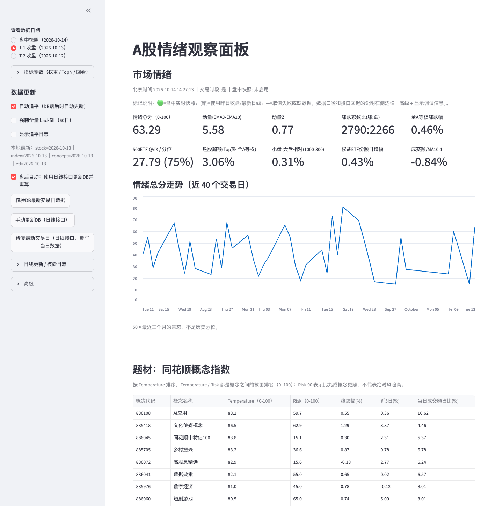

# A股情绪观察面板

每天看盘前后，我想快速回答三个问题：

1. 今天是普涨普跌，还是指数被少数权重撑着？
2. 量能在放还是在缩？资金偏小盘还是偏大盘？
3. 钱在往哪些题材挤，哪些已经涨过头、开始变躁？

这个面板就是用来回答这三个问题的。本地 Streamlit 应用，数据来自 baostock / adata / akshare（免费源），存在本地 SQLite。个人工具，不构成投资建议。



## 面板上看什么

### 1. 市场情绪：5 个因子合成 0–100 总分

| 因子（默认权重） | 计算 | 我怎么看 |
|---|---|---|
| 广度 B（0.35） | 上涨家数 ÷（上涨＋下跌），剔除平盘 | 整体赚钱效应。连续出现超过 4:1 或 1:4 的极端涨跌比，容易出现行情转折 |
| 量能 L（0.25） | 沪深两市成交额 ÷ 10 日均值 − 1 | 市场活跃度，相对近期放大还是收缩。温和放量利于上涨行情延续 |
| 热度 H（0.15） | 成交额前 100 个股平均涨幅 − 全 A 等权涨幅 | 热门股赚钱效应，衡量市场是否存在主线行情 |
| 风格 R（0.15） | 中证 1000 涨幅 − 沪深 300 涨幅 | 大小盘风格，衡量市场偏重投机还是蓝筹 |
| ETF E（0.10） | 股票型 ETF 总份额日变化 | 评估机构资金是流入还是流出 |

总分算法：每个因子在最近 60 个交易日内做稳健标准化（中位数 / MAD，截断在 ±4），按权重加权平均，再用 logistic 函数映射到 0–100。

**50 表示接近最近三个月的常态，不是历史分位。** 权重可以在侧边栏「指标参数」里调。

另外两个读数：

- 动量：总分的 EMA3 − EMA10，看情绪在升温还是降温。
- 500ETF 期权 QVIX 及其近一年分位：只展示，不进总分。

### 2. 题材：同花顺概念指数

- **Temperature**：成交额占比（50%）＋ 占比相对 5 日均值的变化（20%）＋ 5 日涨幅（30%）
- **Risk**：10 日波动（50%）＋ 距 10 日高点回撤（35%）＋ 偏离 10 日均线（15%）

两个分数都是概念之间的截面排名。Risk 90 表示比九成概念更躁，不代表绝对风险高。

`filtered_concept.csv` 剔除了融资融券、沪股通这类覆盖面太宽的概念。它们成交额天然大，不剔除会长期霸榜。

## 运行

需要 Python 3.11+（新版 akshare 的要求）。

```bash
pip install -r requirements.txt

# 第一次先单独补历史。耗时是 2026-10 的实测值：
# 股票约 22 分钟（逐只拉约 5200 只股票的 60 日日线），概念约 3.5 分钟，ETF 约 12 秒
python backfill_stocks.py --db data/a_share_mvp.db --days 60 --with-indexes
python backfill_concepts.py --db data/ths_concept.db --days 60
python backfill_etf.py --db data/etf_mvp.db --days 60 --ref-db data/a_share_mvp.db

streamlit run app.py
```

之后每次打开面板，它会自动补上缺的交易日。侧边栏可以切换三种口径：盘中快照、T-1 收盘、T-2 收盘。数据核验和接口回退的细节默认隐藏，在侧边栏「高级 → 显示调试信息」里打开。

## 文件

| 文件 | 作用 |
|---|---|
| `app.py` | 启动入口 |
| `panel.py` | 面板：读库、算指标、画页面 |
| `backfill_stocks.py` | 沪深 A 股和指数日线（baostock） |
| `backfill_concepts.py` | 同花顺概念指数日线（adata） |
| `backfill_etf.py` | 股票型 ETF 份额（akshare） |
| `filtered_concept.csv` | 题材剔除名单 |
| `tests/` | 离线测试，用合成数据跑通整个页面，不连任何数据源 |

```bash
python -m unittest discover -s tests -t .
```

## 已知限制

- 只存 60 个交易日，所以总分衡量的是"相对最近三个月"的位置，也还做不了回测。
- 盘中模式下拿不到当天的量能和 ETF 份额，这两个因子用的是上一交易日的值。
- 免费数据源的字段和单位经常变，部分成交额单位是靠数值大小推断的。
- 深市 ETF 份额接口可能只返回最新一天，历史要靠每天运行慢慢积累。

## 许可

[MIT](LICENSE)
